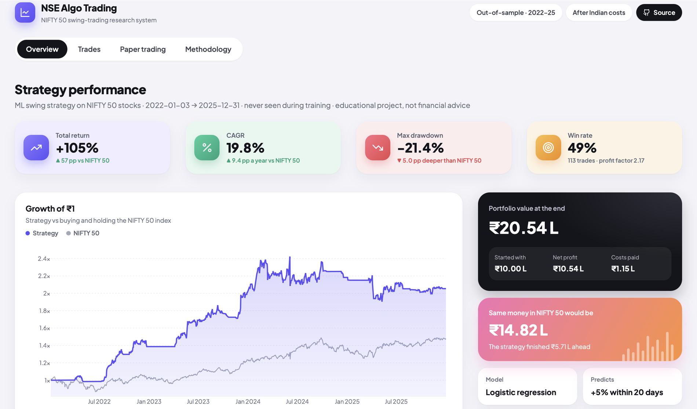
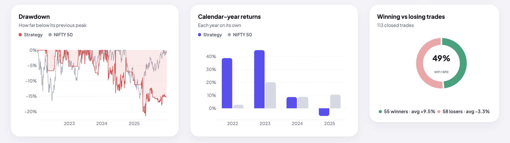

# NSE Algo Trading System

[](https://github.com/krank-09/nse-algo-trading-system/actions/workflows/tests.yml)

A swing-trading system for NIFTY 50 stocks: data pipeline, backtester, paper trading, a Streamlit dashboard and a walk-forward ML model. I built it to learn how a trading idea is tested without fooling yourself, so most of the work went into the backtester and the train/test splits rather than the strategy.

**Live dashboard:** https://algo-trading-system.streamlit.app/ (free hosting, so it can take about 30 seconds to wake up)



Educational project, not financial advice.

## Results

Out-of-sample, 2022–2025, after costs:

| | ML strategy | NIFTY 50 buy & hold | SMA + RSI rules |
|---|---|---|---|
| Total return | +105.4% | +48.2% | −4.4% |
| CAGR | 19.8% | 10.4% | −1.1% |
| Sharpe | 0.75 | – | −0.58 |
| Max drawdown | −21.4% | −16.5% | −21.9% |
| Trades | 113 | – | 964 |

The model is a logistic regression on 25 technical features. It predicts whether a stock will rise more than 5% over the next 20 trading days. It was trained on 2015–2021 only, and the 2022–25 window was scored once. At a 0.6 probability threshold its precision is 0.436, against a 0.280 base rate.



The first version had a leak. The training window ended with a 10-day gap before the test period, but the label looks 20 trading days (about 28 calendar days) ahead, so training labels overlapped the test period. Fixing it (`ml/dataset.py::embargo_for`, with regression tests) dropped CAGR from 20.9% to 19.8%. Everything I tried and dropped is in [`ml/RESULTS.md`](ml/RESULTS.md).

## How it works

- **Data:** about 14 years of daily prices from yfinance, cleaned and turned into features. NSE bhavcopy files are used as a second source to catch gaps in the Yahoo data.
- **Backtester:** a signal on day *t* fills at day *t+1*'s open, with slippage. Every trade pays brokerage, STT, exchange and SEBI fees, stamp duty, GST and DP charges, about 0.29% per round trip.
- **Strategies:** a strategy only says whether it wants to hold each stock (0 or 1) each day. The engine turns that into orders, so the same code runs in the backtest and in paper trading.
- **Paper trading:** a once-a-day loop after market close, with state kept in SQLite.
- **Splits:** tune, validate and holdout periods are frozen with SHA-256 checksums. The 2026+ holdout hasn't been touched yet.

## Running it

```bash
git clone https://github.com/krank-09/nse-algo-trading-system.git
cd nse-algo-trading-system
python -m venv .venv && source .venv/bin/activate
pip install -r requirements-dev.txt
pytest -q                      # no network needed
```

Market data isn't committed. To rebuild everything:

```bash
python main.py --mode fetch-data          # full NIFTY 50 (add --tickers RELIANCE TCS for a quick test)
python main.py --mode clean-data
python main.py --mode build-features
python main.py --mode freeze              # writes data/frozen/ and MANIFEST.json

python main.py --mode backtest --strategy sma_rsi
python -m ml.experiment --final --models logistic --horizon 20 --threshold 0.05 --save ml/artifacts/model.pkl
python -m ml.backtest_ml --split validate --min-proba 0.50 --max-positions 4

python main.py --mode paper-run           # once a day after 15:30 IST
streamlit run frontend/app.py
```

A fresh download won't match `MANIFEST.json` exactly, because Yahoo adjusts old prices. The manifest records the data the results above came from.

## Layout

```
main.py              command-line entry point
data_engineering/    loading, cleaning, features, bhavcopy check, freezing
strategies/          strategy interface, SMA+RSI baseline, ML strategy
backtesting/         engine, costs, metrics
execution/           paper trader and its SQLite store
frontend/            Streamlit dashboard
ml/                  embargoed splits, models, experiments
ipo/                 rule-based IPO scorecard
tests/               pytest suite
```

## Limitations

- The stock list is today's NIFTY 50 applied to the past, which overstates historical returns (survivorship bias).
- 48 of 50 stocks: Yahoo returns errors for TATAMOTORS and LTIM.
- One validation window in one market regime. Most of the gain came in 2022 to early 2024; after that the strategy was roughly flat.
- The drawdown is deeper than the index because it holds only 4 positions at a time.
- Slippage is a flat 5 bps, which is optimistic in fast markets.

## License

MIT
