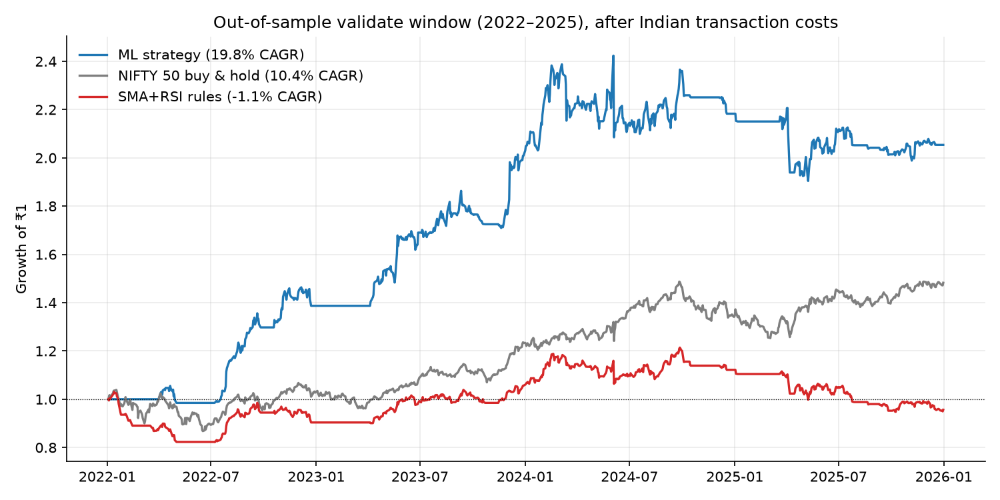

# NSE Algo Trading System

[](https://github.com/krank-09/nse-algo-trading-system/actions/workflows/tests.yml)


An end-to-end swing-trading system for Indian equities (NIFTY 50). It covers a data pipeline with second-source reconciliation, a **look-ahead-free backtester with real Indian transaction costs**, a paper-trading loop, a Streamlit dashboard, and a **walk-forward ML model**.



> ⚠️ **Educational project, not financial advice.** Backtested results don't guarantee future returns.

## Results (out-of-sample, 2022–2025, after costs)

| | ML strategy | NIFTY 50 buy & hold | SMA + RSI rules |
|---|---|---|---|
| Total return | **+105.4%** | +48.2% | −4.4% |
| CAGR | **19.8%** | 10.4% | −1.1% |
| Sharpe | 0.75 | — | −0.58 |
| Max drawdown | −21.4% | −16.5% | −21.9% |
| Trades | 113 | — | 964 |
| Win rate / profit factor | 49% / 2.17 | — | 34% / 0.96 |

The model is a logistic regression over 25 scale-free technical features. It predicts **P(forward 20-day return > 5%)** and was trained on 2015–2021 only, with the last 35 days purged so no training label reaches 2022. Strategy parameters were tuned on 2020–21 using a model trained on data up to 2019, and the 2022–25 window was scored once. On that window, precision at a 0.6 probability threshold is **0.436 vs a 0.280 base rate (1.56× lift)**.

> **Leak found and fixed:** the first version used a 10-day embargo even though the label looks 20 *trading* days (about 28 calendar days) ahead, so the training data saw a few weeks of the test period. Fixing it (`ml/dataset.py::embargo_for`, plus regression tests) cut CAGR from 20.9% to 19.8% and the lift from 1.64× to 1.56×. The edge survived, but it had been slightly inflated.

Full iteration log, including what was tried and rejected: [`ml/RESULTS.md`](ml/RESULTS.md).

## What it does

- **Data pipeline:** about 14 years of daily OHLCV from yfinance → validation and cleaning → 25-column feature matrix. NSE bhavcopy serves as an independent second source to catch silent vendor gaps.
- **Reproducible datasets:** walk-forward splits (tune / validate / holdout) are frozen with SHA-256 checksums.
- **Backtester:** signals on day *t* fill at day *t+1*'s **open**, with slippage. Every trade pays brokerage, STT, exchange, SEBI, stamp duty, GST and DP charges, about 0.29% per round trip.
- **Strategies as desired state:** a strategy returns `{0,1}` per day and the engine converts that into orders. The same strategy code runs in backtest and in paper trading.
- **Paper trading:** a daily end-of-day loop with crash-safe SQLite state.
- **Dashboard:** a read-only Streamlit view of backtests and the paper portfolio.
- **IPO scorecard:** a rule-based scoring of upcoming IPOs from subscription, valuation and issue-structure data.

## Design rules

1. **No look-ahead.** Features at *t* use data ≤ *t*, and orders fill at *t+1* open. Tests check both.
2. **Costs are real.** A strategy that wins only before costs doesn't count.
3. **Time-based ML splits only.** The end of each training window is purged by an embargo that covers the label horizon. No random shuffling of time series.
4. **The holdout (2026+) stays untouched** until the final evaluation.

## Tech stack

Python · pandas · NumPy · scikit-learn · Streamlit · SQLite · pyarrow · yfinance · pytest · GitHub Actions

## How to run

```bash
git clone https://github.com/krank-09/nse-algo-trading-system.git
cd nse-algo-trading-system
python -m venv .venv && source .venv/bin/activate
pip install -r requirements-dev.txt
pytest -q                                              # unit tests, no network needed
```

Market data isn't committed; the pipeline downloads it:

```bash
# 1. Data
python main.py --mode fetch-data --tickers RELIANCE TCS   # quick test
python main.py --mode fetch-data                          # full NIFTY 50
python main.py --mode clean-data
python main.py --mode build-features
python main.py --mode freeze                              # → data/frozen/ + MANIFEST.json

# 2. Rule-based backtest
python main.py --mode backtest --strategy sma_rsi         # → reports/

# 3. ML: iterate on tune, score validate once
python -m ml.experiment --models logistic hist_gbm --horizon 20 --threshold 0.05
python -m ml.experiment --final --models logistic --horizon 20 --threshold 0.05 \
       --save ml/artifacts/model.pkl
python -m ml.backtest_ml --split validate --min-proba 0.50 --max-positions 4
python -m scripts.make_readme_chart                       # regenerate the chart above

# 4. Paper trading (once a day after 15:30 IST) + dashboard
python main.py --mode paper-run
python main.py --mode paper-status
streamlit run frontend/app.py

# 5. NSE bhavcopy reconciliation / IPO scoring
python main.py --mode reconcile --date 2026-09-03
python -m ipo.analyzer                                    # fill ipo/watchlist.yaml first
```

A fresh download won't match `data/frozen/MANIFEST.json` byte for byte, because Yahoo back-adjusts history. The manifest records exactly what the published results were computed on.

## Project layout

```
main.py              CLI entry point
config.yaml          universe (NIFTY 50), dates, paths
data_engineering/    loader → cleaner → features; bhavcopy (2nd source); freeze
strategies/          base contract + registry; sma_rsi; ML strategy
backtesting/         engine (next-open fills), costs, metrics
execution/           paper trader + SQLite state store
frontend/            Streamlit dashboard
ml/                  dataset (embargoed splits), models, experiments, RESULTS.md
ipo/                 IPO scorecard
tests/               pytest suite (costs, metrics, engine, features, splits)
docs/                implementation plan, README chart
```

## Limitations

- **Survivorship bias:** the universe is *today's* NIFTY 50 projected backwards, which overstates historical returns.
- **48 of 50 stocks:** TATAMOTORS and LTIM return 404 errors on Yahoo.
- **One validation window and one market regime.** There's no rolling multi-fold walk-forward yet. Most of the ML strategy's gains came in 2022 to early 2024, and it was roughly flat after that (see chart).
- **Deeper drawdown than the index** on validate (−21.4% vs −16.5%), from holding just 4 concentrated positions.
- **Over the full 2012–2026 period**, the rule-based SMA+RSI strategy returns 7.8% CAGR against NIFTY's 11.6%. It's kept as a baseline, not as a strategy worth trading.
- **Slippage** is a flat 5 bps: reasonable for large caps, optimistic in fast markets.

## Regulatory note (India)

Under SEBI's April 2026 retail-algo framework, staying under 10 orders/sec means no algo registration is needed. Live trading through a broker API requires a whitelisted static IP and OAuth 2FA. IPO applications can't be automated.

## License

MIT. See [LICENSE](LICENSE).
